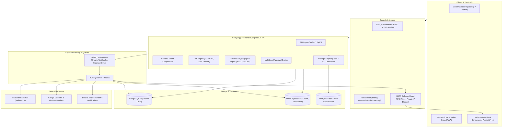

# Entrivo — Enterprise Workplace Visitor Management System

Entrivo is a modern, enterprise-grade, multi-tenant visitor management platform built with Next.js 15 App Router, TypeScript (strict mode), Prisma 6, PostgreSQL, Redis, and BullMQ. Designed for security-critical enterprise campuses, corporate headquarters, and high-security facilities, Entrivo provides end-to-end management of visitor lifecycles, digital NDA execution, touchless check-ins, meeting room bookings, and automated compliance.

---

## Architecture Overview



---

## Key Features

- **Multi-Tenant SaaS Foundation**: Strict logical partition on `organizationId` across all data queries and mutations, auto-discovered and verified across API routes.
- **Enterprise Authentication & 2FA**: HttpOnly session cookies, RFC 6238 TOTP two-factor authentication, 10 single-use bcrypt backup codes, absolute & idle session timeouts.
- **Cryptographic Visitor Passes**: Dynamic QR passes signed via HMAC-SHA256 (`ENTQ1.*`), tamper-evident, and bound to 24-hour expiration windows.
- **Touchless Kiosk & PWA**: Standalone installable PWA terminal, 8-character pairing codes, camera QR scanner, and offline IndexedDB check-in queue with server-wins conflict resolution.
- **Digital NDA Execution**: Configurable rich-text templates, digital signature pad, SHA-256 content hashing, and on-the-fly PDF generation (`pdfkit`).
- **Visitor Pre-Registration (P10-A)**: Invitation-linked, resumable mobile wizard for visitor details, ID, photo, vehicle, privacy consent, and NDA e-signature; hosts can review, approve, reject, or regenerate links before check-in.
- **Emergency Muster (P10-B; backend/API)**: Tenant-scoped emergency events and muster points, snapshotted active-visitor rosters, idempotent roll-call accounting, audited actions, and notification delivery. The current repository has unit tests but no dedicated P10-B acceptance script or dashboard UI.
- **Localization groundwork (P10-C; partial)**: Locale metadata and multilingual notification templates exist, but full application-wide locale routing and localized page coverage are not implemented.
- **Recurring & Group Visits (P10-D)**: Tenant-scoped recurring series, per-visitor QR passes for group invitations, asynchronous CSV previews/imports, and regular-vendor quick re-invites. Existing single-visitor invitation fields remain available for compatibility.
- **Parking & Vehicle Management (P10-E)**: Office parking lots and typed slots, serializable time-window assignments, check-in slot selection, gate entry/exit logs, occupancy and utilization reports, contractor permits, blacklist enforcement, and plate PII lifecycle controls.
- **Delivery / Courier Management (P10-F1)**: Tenants can receive packages with camera proof, AWB/courier details, and employee recipients; recipients receive instant in-app, push, email, and routed chat notifications. Pickup uses a one-time hashed code, optional delegate name, and optional signature; reminders run at 24h/72h and unclaimed packages can be returned.
- **Contractor Compliance (P10-F2)**: Contractor companies, workers, controlled compliance documents, expiry windows, safety induction, work permits, suspend/block controls, and BLOCK/WARN/OFF check-in enforcement reuse the existing document, storage, virus-scan, audit, and notification infrastructure.
- **Visitor Feedback & Analytics (P10-G)**: Delayed post-checkout email feedback, one-tap 0–10 NPS, signed kiosk/desk QR feedback, a protected feedback inbox, detractor alerts, and aggregate visitor analytics. NPS, wait time, no-shows, duration/overstay, host load, approval turnaround, peak-hour heatmaps, busiest days, and comment themes are tenant scoped and EMPLOYEE views are restricted to their hosted visits.
- **Self Check-In (P10-H)**: Visitors can scan the short-lived rotating reception QR, use a personal pass QR, or complete an Email OTP-verified walk-in. Policy-controlled auto, host, or desk confirmation uses existing check-in rules; visitors see live status while authorized staff receive in-app, push, email, Slack, and Teams alerts.
- **Granular RBAC**: Strict role permissions (`SUPER_ADMIN`, `ORG_ADMIN`, `BRANCH_MANAGER`, `SECURITY_OFFICER`, `RECEPTIONIST`, `EMPLOYEE`, `KIOSK`) with privilege escalation guards.
- **Enterprise Integrations**: Outbound HMAC-signed webhooks with exponential retries, Google & Outlook two-way calendar sync, Slack/Teams event routing, and REST API v1 with scoped API keys.
- **DPDP Act 2023 Compliance**: Data retention auto-purging, visitor consent tracking, and self-service data principal access and erasure tooling.

Pre-registration links are bearer credentials: they contain 32-byte random tokens, store only SHA-256 token hashes, expire relative to the visit, and return a generic 404 when invalid or already used. Set `PREREG_TOKEN_TTL_HOURS` to choose the default expiry grace period. Organizations can set the check-in policy to `BLOCK`, `WARN`, or `OFF`. See [`docs/SECURITY.md`](file:///c:/Entrivo/docs/SECURITY.md) for the threat model and [`docs/ENV.md`](file:///c:/Entrivo/docs/ENV.md) for configuration. Run `pnpm test:p10a` for static acceptance checks; set `PREREG_ACCEPTANCE_URL` to run live checks against a disposable invitation, and optionally set `PREREG_EXPIRED_URL` to exercise expiry handling. Never use real visitor links in test logs or tickets.

P10-D recurring and group-visit limits are organization policies (rather than environment variables): group size defaults to 50, CSV imports to 1,000 rows and 5 MB, and recurring materialization to a rolling 30-day horizon. Run `pnpm test:p10d` for static acceptance checks and `pnpm exec vitest run tests/unit/invitation-recurrence.test.ts tests/unit/invitation-bulk-csv.test.ts tests/unit/invitation-series-ics.test.ts` for focused unit tests.

P10-E parking controls are organization policies: vehicle blacklist enforcement defaults to `BLOCK`, and reserved no-show and overstay grace periods default to 30 minutes. Parking assignments lock the slot row inside a serializable transaction and reject overlapping reservations. Run `pnpm test:p10e` for static acceptance checks and `pnpm exec vitest run tests/unit/parking.test.ts` for plate and concurrent last-slot tests.

P10-B exposes tenant-scoped emergency muster APIs and core unit tests (`pnpm exec vitest run tests/unit/muster-core.test.ts tests/unit/muster-notifications.test.ts`); no `test:p10b` acceptance command currently exists. P10-C is partial: existing locale metadata and multilingual notification templates do not provide full localized application pages or locale routing.

P10-G feedback links are bearer credentials: only SHA-256 token hashes are stored, requests expire, and email links are atomically consumed once. Public feedback submission is limited by IP and token, includes a honeypot and comment sanitization, and stores comments with configured retention. NPS and analytics definitions are documented in [`docs/ANALYTICS_DEFINITIONS.md`](file:///c:/Entrivo/docs/ANALYTICS_DEFINITIONS.md). Run `pnpm test:p10g` for static acceptance checks and `pnpm exec vitest run tests/unit/feedback.test.ts` for focused NPS, wait-time, no-show, QR, and heatmap tests.

P10-H uses a 60–120 second HMAC-signed desk QR and random, short-lived visitor session credentials. OTPs and submitted data are never logged; the OTP is hashed and the pending payload is encrypted at rest. Configure `QR_SIGNING_SECRET` and the optional `SELF_CHECKIN_*` values in `.env`. Run `pnpm test:p10h` for static acceptance checks and `pnpm exec vitest run tests/unit/self-checkin.test.ts` for QR expiry/skew, OTP, policy, and state-transition tests.

---

## Local Development (Windows 11 Setup)

### Prerequisites
- **Node.js**: v22.12.0 LTS or higher
- **Package Manager**: `pnpm` v9.15.0 or higher
- **Database**: PostgreSQL 16+ running locally on port 5432
- **Cache/Queue**: Redis 7+ running locally on port 6379 (native Windows or WSL2)

### Step 1: Install Dependencies
Open PowerShell or Command Prompt in the repository root:
```powershell
pnpm install
```

### Step 2: Environment Configuration
Copy the template configuration file:
```powershell
copy .env.example .env
```
Production deployments require strong cryptographic secrets. Generate each using `pnpm gen:key`:
```powershell
pnpm gen:key
```
Required secrets in `.env`:
- `JWT_SECRET`: Minimum 32 characters (HMAC-SHA256 for session authentication tokens)
- `QR_SIGNING_SECRET`: Minimum 32 characters (HMAC-SHA256 for dynamic visitor passes `ENTQ1.*`)
- `CRON_SECRET`: Minimum 32 characters (Bearer token for automated maintenance endpoints)
- `STORAGE_SIGNING_SECRET`: Minimum 32 characters (HMAC-SHA256 for temporary upload/download URLs)
- `APP_ENCRYPTION_KEY`: Exactly 64 hex characters (AES-256-GCM master key for stored credentials)
- `POSTGRES_PASSWORD`: Strong database password

*(For a complete line-by-line guide of all environment variables, see [`docs/ENV.md`](file:///c:/Entrivo/docs/ENV.md))*

### Step 3: Database Migration & Realistic Seed
> [!IMPORTANT]
> Always deploy migrations using `prisma migrate deploy` (or `pnpm exec prisma migrate deploy`). **Never use `db push` in production**, as versioned migrations guarantee safe, auditable schema transitions without data loss.

Run database migrations and the idempotent seed:
```powershell
pnpm exec prisma migrate deploy
pnpm prisma:seed
```
*The seed creates realistic demo organizations (Acme Global), branches, departments, employees across all roles, active visitor records, and approval workflows. Seed credentials are encrypted and outputted upon execution.*

### Step 4: Run Development Services
Start the Next.js development server:
```powershell
pnpm dev
```
In a separate terminal window, start the BullMQ background worker:
```powershell
pnpm worker:dev
```
Open [http://localhost:3000](http://localhost:3000) to access the Entrivo portal.

---

## Docker Quickstart

To spin up the entire Entrivo platform (Postgres, Redis, Next.js Web App, and BullMQ Background Worker) in Docker:

```bash
docker-compose up -d --build
```

Services will be accessible at:
- **Web Application**: [http://localhost:3000](http://localhost:3000)
- **Healthcheck**: [http://localhost:3000/api/health](http://localhost:3000/api/health)
- **PostgreSQL**: `localhost:5432`
- **Redis**: `localhost:6379`

*(For detailed production deployment instructions, see [`docs/DEPLOYMENT.md`](file:///c:/Entrivo/docs/DEPLOYMENT.md))*

---

## Quality & Testing Suites

Entrivo includes comprehensive automated test suites covering unit logic, tenant isolation, and end-to-end browser flows:

### 1. Vitest Unit Test Suite
Runs all 36 unit tests covering RBAC permissions, tenant helpers, cryptographic QR signing, TOTP 2FA, notification templates, policy schemas, approval state machines, and timezone shifts:
```bash
pnpm test
```

### 2. Tenant Boundary Isolation Audit
Auto-discovers and audits all 108 API routes in `src/app/api`, verifying tenant isolation and access denial:
```bash
pnpm test:tenant
```

### 3. Playwright End-to-End Suite
Launches headless Chromium testing critical user journeys (login with 2FA, visitor check-in with QR pass, kiosk pairing, offline sync, RBAC navigation):
```bash
pnpm test:e2e
```
All Playwright runs require `E2E=1` and a dedicated `E2E_DATABASE_URL`; the guarded Windows setup command is below.

#### P11-U7a authenticated smoke tests (Windows PowerShell)
Set `E2E_DATABASE_URL` to a dedicated PostgreSQL database whose name contains `test` or `e2e`, and set `E2E=1`; never point this at a production or shared non-test database. The setup fails clearly if either requirement is missing, applies migrations only after the guard, resets the deterministic E2E organization on each run, and seeds four test accounts with per-run random passwords held only in process environment variables.
```powershell
$env:E2E_DATABASE_URL = 'postgresql://<user>:<password>@localhost:5432/entrivo_test'
$env:E2E = '1'
pnpm test:e2e:7a
```
The smoke specs exercise 390×844 mobile and 1440×900 desktop layouts and fail on critical axe findings or browser console errors.

### 4. Full Quality Regression
Run TypeScript type-checking, production build, and security audits:
```bash
pnpm exec tsc --noEmit
pnpm build
pnpm audit
```

---

## Project Documentation Index

- [`docs/SECURITY.md`](file:///c:/Entrivo/docs/SECURITY.md): Threat model (STRIDE), SSRF guard, cryptographic signatures, and security checklist.
- [`docs/DEPLOYMENT.md`](file:///c:/Entrivo/docs/DEPLOYMENT.md): Production containerization, Vercel deployment, Windows Server service configuration, BullMQ worker, and crons.
- [`docs/ENV.md`](file:///c:/Entrivo/docs/ENV.md): Exhaustive 36-variable specification with defaults and production requirements.
- [`docs/SETTINGS_ENFORCEMENT.md`](file:///c:/Entrivo/docs/SETTINGS_ENFORCEMENT.md): Typed policies registry, validation rules, and enforcement mechanisms.
- [`docs/PROGRESS.md`](file:///c:/Entrivo/docs/PROGRESS.md): Detailed 10-phase development and compliance ledger.
- [`docs/DECISIONS.md`](file:///c:/Entrivo/docs/DECISIONS.md): Architectural decisions log from Phase 0 through Phase 9.

---

## License

Proprietary enterprise software. All rights reserved.

