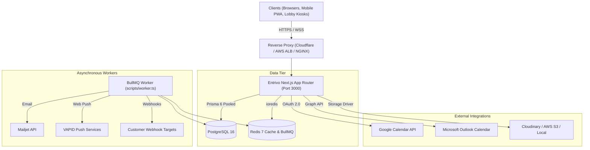

# Entrivo Production Deployment Guide (`docs/DEPLOYMENT.md`)

This guide outlines deployment architectures, configuration requirements, and operational procedures for running Entrivo in production environments.

---

## 1. System Architecture



---

## 2. Docker & Containerized Deployment

Entrivo includes a production-ready, multi-stage [`Dockerfile`](file:///c:/Entrivo/Dockerfile) and [`docker-compose.yml`](file:///c:/Entrivo/docker-compose.yml) orchestrating PostgreSQL, Redis, the web application, and the asynchronous BullMQ worker.

### Quick Start with Docker Compose

1. **Clone repository and configure environment**:
   ```bash
   cp .env.example .env
   # Edit .env with your production secrets (JWT_SECRET, QR_SIGNING_SECRET, etc.)
   ```

2. **Launch all services**:
   ```bash
   docker compose up -d --build
   ```

3. **Verify running containers**:
   ```bash
   docker compose ps
   ```
   Output:
   - `entrivo-postgres`: Up (healthy) on port 5432
   - `entrivo-redis`: Up (healthy) on port 6379
   - `entrivo-app`: Up (healthy) on port 3000
   - `entrivo-worker`: Up (running background queues)

4. **Verify Health Endpoint**:
   ```bash
   curl -I http://localhost:3000/api/health
   # Returns HTTP 200 OK
   ```

---

## 3. Vercel Serverless Deployment

When deploying to Vercel:

1. **Database & Redis**:
   - Provision a PostgreSQL database (e.g. Neon, Supabase, or AWS RDS).
   - Provision a managed Redis instance (e.g. Upstash Redis).
   - Configure connection pooling in `DATABASE_URL` with `pgbouncer=true`.

2. **Environment Variables**:
   - Add all required variables specified in [`docs/ENV.md`](file:///c:/Entrivo/docs/ENV.md) to your Vercel Project Settings.

3. **Background Worker & Cron**:
   - For serverless environments where a long-running BullMQ worker process is not hosted, scheduled cron routes are triggered via `vercel.json`:
     ```json
     {
       "crons": [
         {
           "path": "/api/cron/reminders",
           "schedule": "0 8 * * *"
         },
         {
           "path": "/api/cron/auto-checkout",
           "schedule": "0 20 * * *"
         },
         {
           "path": "/api/cron/data-retention",
           "schedule": "0 2 * * 0"
         }
       ]
     }
     ```
   - All cron endpoints require `Authorization: Bearer <CRON_SECRET>` headers.

---

## 4. Windows Development & Production Setup

For teams hosting Entrivo on Windows Server 2022 / Windows 11:

1. **Prerequisites**:
   - Node.js 22 LTS
   - pnpm (`corepack enable && corepack prepare pnpm@latest --activate`)
   - PostgreSQL 16 Windows Service or Docker Desktop
   - Redis for Windows (or Redis via WSL2 / Docker)

2. **Database Push & Seed**:
   ```powershell
   # Synchronize Prisma schema with PostgreSQL
   pnpm exec prisma db push

   # Seed realistic demo data
   pnpm prisma:seed
   ```

3. **Build and Run**:
   ```powershell
   pnpm build
   pnpm start
   ```

4. **Launch Background Worker (Separate Session / Windows Service)**:
   ```powershell
   pnpm worker
   ```

---

## 5. Security & Operational Checklist

- [ ] `JWT_SECRET`, `QR_SIGNING_SECRET`, and `CRON_SECRET` generated using `crypto.randomBytes(32).toString('hex')`.
- [ ] `APP_ENCRYPTION_KEY` configured as a 32-byte Base64 key for AES-256-GCM field encryption.
- [ ] Database credentials not shared across development and production environments.
- [ ] Automated health checks monitor `/api/health` with alerting for database or redis degradation.
- [ ] SSL/TLS terminated with HTTP/2 and modern ciphers enabled.

